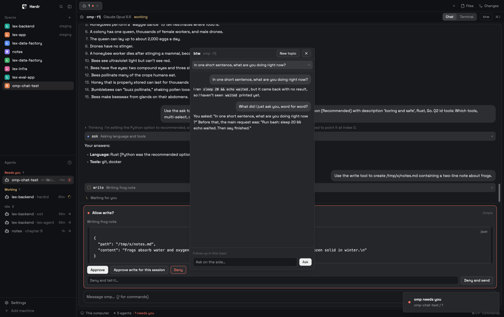

# omp chat

Each omp (oh-my-pi) agent shown as an easy-to-read chat: your messages as bubbles, replies as markdown, work folded, approvals and `ask` questions as cards you answer with a click, and a btw sidebar for side questions while the agent keeps working. Any omp pane flips between its terminal and a chat pane in the same place; chat panes split, zoom and close like any pane. Needs omp 18.18+ with the `omp-chat-bridge` extension, and `bun`.



## What you see

The `omp-chat` layout is Herdr's `main` layout with these changes:

- **Panes**: the tab's panes as in `main`, except that an omp pane can be in chat mode: a chat pane (Herdr mod pane, `background`) in its place, with its own draft, scroll and cards. Several omp panes in a tab can each be chat or terminal.
- **Frosted glass** (macOS style, after the Rex terminal): Herdr can't blur what is behind its window, so the root's `background` is `{image: "backgrounds/omp-chat-glass.jpg", fit: "cover"}`, a copy of the desktop picture blurred by `install.sh` (`tools/glass-backdrop.swift`: Core Image gaussian blur, sigma 60 at 1600px, saturation 1.6, brightness −0.04; `OMP_CHAT_WALLPAPER` picks another picture). Everything over it is translucent theme color, alpha suffixes from `GLASS` in `omp-chat-shared.js`: sidebar, tab bar and Usage on `chrome` at `8c`; chat panes, pane headers and btw on `background` at `b8`, terminals at `terminal_opacity` 0.48, which samples the same over the backdrop (Herdr's terminal tint is not linear: 0.72 is near opaque); tool input/output boxes and the reply boxes on `background` at `59`. The sidebar, pane frame and btw block have no paint of their own; inactive tabs are clear, the active one `raised` at `b8`. Without the image (no `swift`, no picture file) the layout shows a plain dark canvas.
- **Pane header** (30px, Herdr's `pane` header): program icon, name, folder, agent status; on hover, before Herdr's split / zoom / close, three icon buttons (22px high, 6px side padding, 14px line icons in `muted`, the current mode `foreground` on `selected`, 5px radius): chat bubble, terminal prompt, a thin divider, sidebar panel for btw (`working` while a side question runs). A chat pane's header reads `omp` with a chat icon, omp's folder, and a spinner while omp works. Panes without omp show Herdr's header unchanged.
- **btw sidebar** right of the panes, left of Herdr's Files / Changes panel (400px, 300–800, hidden until opened; 10px radius card).
- **Usage panel** in the left sidebar under Agents (215px): a `Usage` heading like Agents' (11.5px `dim`) with the last refresh time (a spinner while reading; click to refresh). Per provider account with anything used (others are left out): its name (`Anthropic`, 12px medium) and account in `dim`, then one row per limit window, session (5 hour) first, then day, week, month: the window's name in `muted` (the limit's own label when two share a window), the percentage left (or left/limit for counted limits), the time to its reset in `dim`, and a 4px bar of what's left (`accent`; `working` from 70%, `blocked` from 90% or when exhausted). Untouched limits are hidden, except an active account's session window. Hover: when it resets. Narrower than 120px (the rail): every shown limit as its window (`5h`, `7d`, `mo`), the percentage left and a 3px bar, 10px, at the block's foot; hover names account and window.
- **Sidebar status colors**: expanded and collapsed, no status dots: the avatar or icon carries the status. Collapsed, Spaces shows each space's letter avatar (a worktree its branch mark) steady: the working color with a halo of it behind (the color at `70` alpha, a 28px square of radius 10 for badges and agent icons alike) slowly breathing (opacity 1 → 0.35, 2.4s) while an agent in it works, the done color with the same halo, still, when one finished unseen, red when one needs you, otherwise in the space's own color (`space.colors`), grey only without an agent; Agents each agent's icon the same way (idle: its space's color, so a space's idle agents share one): an omp's session icon (the emoji or glyph that starts omp's title, as `/resume` shows; read every 10s from the first line of the session file the bridge's `state.json` names), else its program icon (a picture icon keeps the status mark beside it); neither blinks (the working halo breathes instead); hover names them with their status. Omps shown as chat panes count: Agents lists them in their chat pane's place (click focuses the chat pane), and their status rolls up into their space's. In the rail, agent rows sit 8px in from each side like the spaces', so a selected agent's box is the same rounded square. The rail starts below 120px (Herdr's mods: 160px); from 84px it also names each row (space name, agent tab title, `Session`/`Week`), below that icons only. The agents list has no » expand button: the sidebar toggle sits in the brand row, and on the macOS rail, where the traffic lights cover that row, in the footer next to Settings. These are clones of Herdr's `spaces`, `agents` and `workspace-chrome` mods (`omp-chat-spaces`, `omp-chat-agents`, `omp-chat-chrome`, made with `mod.clone`; the chrome clone changes the threshold and drops the footer's Add machine row; `sidebar-footer` is 41px), changed in their status marks (both widths), their rail rows, and in adding chat panes' omps (a parked terminal drops out of `agents()` and the space's status). Their icons are Herdr's stock mods' (`mods/workspace-chrome/…`, `mods/tabs/…`).

The chat, top to bottom:

- **New chat**: with no messages yet, omp's welcome banner centered as the terminal shows it: its logo in its pink → violet → cyan diagonal gradient (`logo.svg`, 8×16 cells), the `omp` half-block wordmark in `foreground` (`wordmark.svg`) with the version under it in `dim`, and a tip under them (`**Tip:**`, 13px `muted`, at most 480px), picked by omp's own banner code.
- **Conversation**, newest at the bottom, 20px side padding:
  - your messages: right-aligned bubbles on `selected`, 14px radius, at most 82% of the width; a steer (a message sent while the agent worked) carries a small `steer` label.
  - replies: markdown (headings, lists, code blocks), 13.5px, selectable, with omp's figures: a ```mermaid fence as omp's text-art diagram (in a code block), a ```svg fence as an image, and under a numeric table the chart omp would draw. LaTeX is drawn as omp draws it, with omp's own modules (`latex-to-unicode`, `latex-block`, `math-delimiters` from `~/.omp/plugins`): inline `$…$`/`\(…\)` as Unicode (`rₘ(d)`, `≈`), own-line `$$`/`\[` blocks as omp's 2D text layout in a code block. Code spans and fences stay as written, `$5 and $10` stays text, and Copy still copies the LaTeX source. Your own messages keep their LaTeX as typed (the sent-message match compares that text). Figures use the theme's colors (svg tokens `var(--fg)`, `--accent`, `--c1`…) and fit the column, at most 560px high.
  - work: each run of tool calls between messages is one row: `▸`, `Worked` (or a spinner and `Working` while a call runs), `N steps`, `K failed` in `blocked` when any failed, and the last call's name and summary in `dim`. Opened (`▾`), the calls follow as rows: a status mark (`◌` running in `working`, `●` done in `done`, `✕` failed in `blocked`), the tool name in the terminal font, the call's intent (or its command / path) in `muted`, `▸`; a call opened shows its input and output as code blocks (max 320px each).
  - thinking is not shown.
  - `⧉ Copy` (11.5px `dim`) under each finished answer: copies that turn's reply text (all its text blocks), then reads `✓ Copied` in `done` for 1.5s.
  - compactions: a bordered `Compacted ▸` card with the summary inside; custom notices as small centered pills; errors in `blocked`.
  - `Earlier messages ▴` at the very top when older messages exist; `⠋ Working…` (or `Waiting for you` when a card is open) at the bottom while the agent runs.
  - a jump-to-latest button once you scroll up: a 26px circle at the bottom right on `raised` with a `border` outline (`hover` on hover) and a 13px down-arrow icon in `muted`, so it follows the light or dark theme.
- **Cards** above the reply box, one per open request:
  - approval: `blocked` border, `● Allow bash?`, the cwd on the right, the call's intent, the command (shell syntax) or the arguments (JSON) in a scrollable code box (max 220px), other shell arguments (`cwd: …`) as a line under it, buttons **Approve** (primary), **Approve bash for this session**, **Deny** (red outline), and a field "Deny and tell it…" with **Deny and send**.
  - ask: `accent` border, `omp asks N questions`, each question with its options as pills (`○/◉` single, `☐/☑` multi), an "Or your own answer…" field per question, and **Answer**.
  - a problem (the dialog changed on screen) shows in red with a **Terminal** button.
- **Reply box**: a text area (1 to 8 lines, growing) in a 12px-radius frame; set into the frame's top border at the right, as omp's editor shows it, omp's status line, short (11px `muted`, at most 220px, a 16px chip on `popover` with an `input` outline over the border, since on glass no flat color can hide the line under it): the reasoning effort as omp's circle icon (its Unicode symbols: ○ minimal, ◔ low, ◑ medium, ◒ high, ◕ xhigh, ◉ max; none for off/auto), the model without "Claude " (truncated), and a 40×4px context bar (`accent`, `working` from 60%, `blocked` from 85%), no number (hover: model, effort, percentage and tokens of the window); without a known window, the token count instead; hidden until a model is known. On the frame's right, on the text's row: a stop button `■` (outlined) while the agent works, and the send button `↑` (`solid` when there is text). Typing `/` opens a list of up to 8 commands above it: `/name` in the terminal font and its description in `dim`. As in omp, ↑ ↓ move the highlight and Tab fills the highlighted command in (a click does too).

The **btw sidebar**: a title row `btw  omp · t1j` with **New topic** and `✕`; the topics (newest first, max 150px, a spinner on the running one, `+N` follow-ups); the selected topic's turns (question bubbles, markdown answers, once complete each with a copy icon at the right under every code block, table, blockquote and `$$` equation and one under the answer, errors in red); "New topic" / "Follow-up in this topic" over a text area (wraps, grows to 6 lines; Enter asks, Shift+Enter a new line) with **Ask** (or **Cancel** while one runs).

## How it behaves

- **Which omp**: a chat pane shows the omp it was opened for, for its whole life. The btw sidebar follows the focused pane's omp (a chat pane's or a terminal's), else the tab's first.
- **Chat ⇄ terminal**: `⌘J` on the focused pane, or the header's chat / terminal icons, flips that pane. To chat: a chat pane is split off the terminal pane and the terminal is parked (`terminal.park`: it keeps running without a pane), so the chat takes its place. To terminal: `terminal.keep` gives the terminal a pane next to the chat pane, which then closes, so the terminal is back in the same place. A chat pane's ✕ goes back to the terminal and closes it, ending omp as closing a terminal pane does; closing its tab ends the parked omp too. While a pane is in chat mode its omp is not in Herdr's Agents list and Herdr's own alerts for it don't fire: the chat posts a toast and the blocked sound for a new card when its pane isn't on screen.
- **Follow**: the chat opens at the newest message and follows new ones as omp writes them. An answer streams in as omp writes it (about 7 updates a second), as plain markdown; once the transcript holds it, the transcript's version replaces it, with figures and LaTeX drawn. Scrolling up stops following (the down-arrow button brings it back) and, at the top, loads 150 older messages.
- **Clicks** on a work row, a tool row or a compaction card fold/unfold it; on a Copy row, copy the answer.
- **Copying a block**: every code block (any language, ```markdown included), table, blockquote, diagram (mermaid art or svg) and display equation in an answer has its own copy icon right under it, at the right edge like the answer's under the answer, so blocks keep the full width. It copies the block's source: the code without its fence, the table's markdown (math in it as drawn), the mermaid/svg source, the LaTeX of the equation, the quote's text without its `>` marks.
- **Usage**: `omp usage --json` (what omp's `/usage` shows: every authenticated account's rate-limit windows, fetched from the providers) every 5 minutes and on a click on the time.
- **Sending**: as in omp's editor. Enter sends; Shift+Enter starts a new line; Ctrl+Enter (or Cmd+Enter) queues the message to run after the current turn (omp's follow-up; a plain send when idle). Plain text goes to omp as your message (it steers if the agent is working, starts a turn if idle). Text starting with `/` is typed into omp's terminal so omp runs it as a command; commands that open a screen there (`/model`, `/settings`, `/tree`, bare `/btw`, …) also switch this pane to the terminal. With the `/` list open, ↑/↓ move, Tab or Enter take the highlighted command, Esc closes the list.
- **Resume**: `/resume` (bare) opens the chat's own session list over the conversation instead of omp's terminal picker: this project's sessions newest first (omp's title, else the first message; how long ago), a search field, the current one marked. Clicking one switches this omp to it and the chat follows; Esc or `✕` closes the list.
- **Files**: `@` in the reply box lists the omp folder's files and folders (`rg --files`, so what git ignores is left out; read again after 30s), best match first; Tab, Enter or a click puts in `@path` (quoted when it has a space), a folder keeps the list open on what's inside. omp reads every sent `@path` that names an existing file into the turn, as in its terminal. Needs `rg`.
- **Drafts**: unsent text stays with its omp: flipping to the terminal and back puts it back in the box.
- **Stop and rewind**, as in omp: `■` or Esc while the agent works aborts the turn. Esc with a draft does nothing (the draft is kept). Esc twice within 0.5s on an empty box, while idle, rewinds past your last message: the conversation goes back to before it (omp's leaf moves there, as with its rewind selector) and the message comes back into the reply box to edit and resend. Again goes back one more message.
- **Cards** appear when omp asks to approve a tool call or asks a question, and close when it's answered, here or in the terminal. Each button checks omp's screen first and sends the matching keys; if the dialog isn't what the card describes, nothing is sent. If a card appears while you can't see that chat, a toast "omp asks to run bash" (click: go to the tab) and the `blocked` sound.
- **Agent status**: the chat pane header's spinner while omp runs a turn.
- **btw**: the header's btw icon or `⌘⇧J` shows or hides the sidebar. Asking starts a new topic (or a follow-up in the selected one, which keeps that topic's earlier turns as context). The answer streams in while the main agent keeps working; nothing appears in omp's terminal and nothing is added to its transcript. One side question runs at a time; **Cancel** stops it; `✕` or Esc (empty input) hides the sidebar.

## Built from

- **Layout** `layouts/omp-chat.json`: `main` without the bottom `status` block (`workspace-status`), with the tab block's pane header set to `{mod: "omp-chat", props: {view: "header"}}` (height 30, top, always); `spaces`, `agents`, `brand`, `sidebar-footer` and `tabs` pointed at the clones `omp-chat-spaces`, `omp-chat-agents`, `omp-chat-chrome` and `omp-chat-tabs` (its Files and Changes panel buttons are 26px icons only, named on hover; a tab whose omp is a chat pane keeps that omp's program icon, from the parked terminal in `terminals()`); a block `omp-stats` (`size {px: 215}`, `min 60`, `{mod: "omp-chat", props: {view: "stats"}}`) appended to `sidebar-lists` under `agents`; and between the tab block `main` and `panel` (Files / Changes) a block `omp-btw` (`hidden`, `size {px: 400}`, `min 300`, `max 800`, `{mod: "omp-chat", props: {view: "btw"}}`). Chat panes are mod panes made at run time: `pane.split {pane, direction: "right", mod: "omp-chat", props: {view: "chat", terminal}}`. `preview: layouts/omp-chat.svg`.
- **Keys**: section `layout:omp-chat`: `cmd-j` → `omp-chat.toggle`, `cmd-shift-j` → `layout.toggle:omp-btw`. Ctrl+Enter, Shift+Enter and Esc are handled by the chat itself.
- **Mod** `mods/omp-chat` (`place: none`, `focusable: true`), one mod with four roles by `props.view` (a copy with `props.pane` and no view is a header): `chat` (`chat.js`, a chat pane), `header` (`header.js`, Herdr's shipped `pane` header plus the chat / terminal / btw buttons, which it draws), `btw` (`btw.js`), `stats` (`stats.js`). In the chat pane, `chat.js` follows the bridge and the transcript, streams the answer and lays out the measured feed; `rows.js` turns transcript items into feed rows and draws them; `cards.js` holds the approval and ask cards; `composer.js` is the reply box (the / commands, sending, stop, rewind, the status line); `picker.js` is the `/resume` list. `common.js` has what the views share: the reply box's Enter handling, the Copy buttons, the list keys, the spinner, `~` paths. `view.js` switches a pane between chat and terminal; `channel.js` reads the bridge's files and keeps `shared("omp-chat.panes")` (chat pane id → terminal, for headers and the sidebar); `answer.js` answers dialogs; `transcript.ts` + `render.ts` are the Bun helper.
- **Shared** `mod/shared/omp-chat-shared.js`: what `omp-chat` and the rail clones share (the chat panes' omps and their status, the rail widths, space colors, program and session icons). Herdr won't import from another mod's folder, so each mod links it as `./omp-chat-shared.js` and `install.sh` copies the file itself into each installed mod.
- **herdr**: `exec("bun", [transcript.ts, file, "--limit", n, "--leaf", id, "--after", id, "--palette", json, "--app-home", dir])`, `exec("bun", [transcript.ts, "--sessions", dir])`, `hc(["read"|"keys"|"send", …])`, `readTextFile`, `writeTextFile` (requests), `watchFolder` (the bridge folder and the session's folder), `fs/promises.readdir`, `panes`, `focused`, `shared`/`setShared`, `nextCommand`, `run("pane.split"|"pane.close"|"pane.focus", …)`, `run("terminal.park"|"terminal.keep"|"terminal.kill", {terminal})`, `run("layout.toggle"|"layout.hide", {id: "omp-btw"})`, `run("pane.focus", {terminal})`, `notify`, `playSound("blocked")`, `cx.write_to_clipboard` (Copy). gpui-kit `image` (figures from `data/omp-chat-render/`); gpui-base `v_virtual_list` + `VirtualListScrollHandle`, `TextView.markdown`, `TextareaState`/`Textarea`, `InputState`/`Input`, `Scrollbar`.
- **Extension** `~/.omp/agent/extensions/omp-chat-bridge.ts` (a symlink). Active only when `HC_TERMINAL_ID` is set, `OMPCODE` isn't, and the session is the main one with a UI. Folder `<appHome>/data/omp-chat/<terminal>/`, every write atomic (tmp + rename, mode 600):
  - `state.json` `{terminal, sessionFile, sessionId, cwd, model, thinking, context: {tokens, window, percent}, busy, btwRunning, leaf, welcome: {version, tip}}` (rewritten on lifecycle events, and every 2s when something changed). A bridge loaded before `thinking`/`context` existed doesn't report them: the chat then uses the transcript helper's `status` (the last answer's model, `requestControls.effort.topLevel` and `usage.totalTokens`, with the window from `~/.omp/agent/models.db`, a numbered second account like `anthropic-2` looked up under its base provider); `welcome` comes from `VERSION` (`@oh-my-pi/pi-utils`) and a `WelcomeComponent`'s `tip` (`@oh-my-pi/pi-tui/prompt/welcome`, imported dynamically: the compiled omp exposes only some subpaths, `pi-utils/dirs` not among them), the nerd-font nag skipped and key placeholders written as code; `leaf` `{id, after}` is set on `session_tree` and after a rewind (the leaf moves without an append, so the reader can't see it in the file);
  - `pending.json` cards from `tool_call` + `tool_execution_start` + `tool_approval_requested`/`resolved` and `ask`'s `tool_execution_start`/`end`;
  - `commands.json` omp's built-ins (its own registry) + `pi.getCommands()`;
  - `btw/<id>.json` topics in omp's `BtwHistoryRecord` shape plus `sessionId`;
  - `requests/*.json` from the mod: `{type: "prompt", text, followUp?}` → `pi.sendUserMessage` (with `deliverAs: "followUp"` when asked and busy); `{type: "abort"}` → `ctx.abort()`; `{type: "btw", question, followUpOf?}` → `ctx.runEphemeralTurn` with the `/btw` prompt, the topic's earlier turns as `history`, a per-topic `conversationKey`, deltas written ~10/s; `{type: "btw_cancel", id}` → abort.
  - the command `/omp-chat-rewind <user entry id>`: `ctx.navigateTree(id, {summarize: false})` (only command handlers may move the leaf), then empties omp's own editor. The chat types it with `hc send`; it is left out of `commands.json`.
  - the command `/omp-chat-resume <session file>`: `ctx.switchSession(file)`, then empties omp's editor; typed by the chat's resume list, also left out of `commands.json`.
  - outside that folder, `<appHome>/data/omp-chat-stream/<terminal>.json` `{id, blocks, done}`: the text blocks of the assistant message being written (`message_update`, at most every 120ms; `done: true` on `message_end`). Kept apart so its writes don't wake what watches the bridge folder (headers, btw).
  The folder and the stream file are removed on `session_shutdown`.
- **Programs**: `bun` (session reader, figures), `hc`, `omp usage --json` (Usage). Figures use omp's own modules from the plugin install (`~/.omp/plugins/node_modules/@oh-my-pi`: `pi-natives` `renderMermaidAscii`, `pi-tui` `prepareSvg`, `splitTableCharts`/`lookupTableChart` under `setTableCharts("always")`); `render.ts` loads them only for answers holding a fence or a table.

## Watch out

- A frame paints its border over its own children: to cut a border line (the status label in the reply box's top border), put the label in a wrapper as the frame's later sibling, absolutely placed, with the background's color.
- Never start the Herdr window from inside a Herdr terminal (`herdr-app &`, even `open -a`): it inherits that terminal's `HC_TERMINAL_ID`, and every `hc send` the mods make is then wrapped as a message from that terminal, so a `/command` reaches omp as `<hc from="t2m">/restart</hc>`. Restart it with `herdr-app do app.quit`, then `env -i HOME="$HOME" USER="$USER" LOGNAME="$USER" SHELL="$SHELL" TMPDIR="$TMPDIR" LANG="$LANG" PATH=/usr/bin:/bin:/usr/sbin:/sbin /usr/bin/open -a /Applications/Herdr.app` (or from the Dock); check with `/bin/ps -wwE -p <pid> -o command`.

- The streamed answer: the chat reads the stream file every 150ms while omp works (`STREAM_POLL_MS`), and not otherwise; it shows the blocks after the last row until a transcript text equals the last block, and a `done` one at most 5s (`STREAM_GRACE_MS`, the transcript is re-read every second). A `watchFolder` loop on that folder (with `fs/promises` in `chat.js`) left every mod view at "This view could not be re-rendered … out of memory" / `Null"null"`, and reloading didn't recover it: only `app.quit` and reopening the window did. Poll it; keep an eye on `herdr-app status` errors after touching it.

- Herdr turns `done` into `idle` once the terminal is on screen, and a parked omp never is (no command marks it seen; the `herdr.seen` label doesn't do it). While a chat pane is on screen and its omp is `done`, the chat records the terminal's `turn` in shared `omp-chat.seen` (live terminals only); the sidebar clones show that turn's `done` as idle.

- Working or not comes from Herdr's status for the omp's terminal (`terminals()`, what the terminal view shows; checked every second), the bridge's `busy` only without one: an `agent_end` with `willContinue` that never continues left `busy` on. The bridge also clears `busy` on its 2s tick when `ctx.isIdle()`.
- A message sent from the chat shows at once as your bubble with the working row under it, until the transcript holds it (omp writes the session file, for a new session its folder too, only with the first turn; the chat watches for that folder every second until it exists), or for two minutes.
- `watchFolder` on omp's sessions folder can stay silent while omp appends to the session file (seen on macOS): while omp works or a sent message waits, and once after, the chat re-reads the transcript every second. Without this a reply never showed and the working row stayed.
- The Copy row is a 24px icon button at the row's right edge (in the chat and in btw), no label (hover: `hover` background, `foreground` icon); the list's `on_item_click` has no position, so the chat records where the press landed (`on_mouse_down` on the feed) and ignores row clicks beside the button. Blocks work the same way: `render.ts` `answerParts` splits an answer into parts (the code/table/`$$` cutting is `blocks.js`, shared with `btw.js`) (prose, and each block with its source as `copy`), each part is a feed row `<item id>#<i>`, and a block's copy button is a copy row `copy:<item id>#<i>` under it. A hover-only icon doesn't work: list rows can't hold hover handlers, and a row's hover text color did not reach the icon (it stayed invisible).

- The text box's own key bindings (context `Input`: ↑ ↓ move the cursor, Tab indents) run before any `on_key_down`. While a list is open, its text box sits in the `OmpChatList` key context, and `cx.bind_keys` (once per app) binds ↑ ↓ Tab there (`OmpChatList > Input`) to actions the wrapper handles with `on_action`.

- The feed's row heights: measure every unmeasured row in one pass, only once the pane's width is known, and keep a row's last height until it is measured again. Keep a measured row in the measurer until its height has held for 1.5s (`MEASURE_SETTLE_MS`): a long answer's markdown (several thousand characters, tables) lays out after its first frame, so its first height is just its padding, and dropping it then leaves the answer blank above its copy button. Rows at 0 or measured a few per frame shift the list under the reader. After "Earlier messages" loads, pin the row that was on top until the rows above it are measured. "At the top" is the virtual list's last render call of a frame starting at row 0: the first call each frame measures one row, always from 0, so it says nothing about the scroll. Load that next batch (150 more) only once the scrolling, trackpad momentum included, has stopped for 400ms (the row reads "Loading earlier messages…" meanwhile), so nothing else moves the list as the rows land. Pin it by an item it holds (a work row's last call), never by row id: a work row's id names its first call, and the earlier page usually adds calls to that same run.
- The rail clones never get Herdr's updates to `spaces` and `agents`: re-clone and re-apply the rail rows after a Herdr update changes them.

- `list()` can't be scrolled from code (its handle is for virtual lists) and starts over at the top when its item count changes. The chat uses `v_virtual_list` with heights measured off screen (every unmeasured row in one pass, at the pane's width; see the row-heights note above) so it can follow the bottom.
- Inside list renderers no handlers: folding uses `on_item_click` on the list, so a whole row is the click target.
- Extensions can't answer tool approvals: the cards press keys. omp ignores keys for a moment after drawing a dialog, so answers wait until 1s after the card appeared. Approval rows: `↑/↓` to the row, Enter; deny-and-steer is `hc send --force` with the text (typing denies and steers). Ask: per question move to the option and Enter (single), Space on each choice then Enter (multi), or Enter on `Other (type your own)` then `hc send --force` the text; a multi-question ask ends on a review where Enter submits. The cursor glyph is a Nerd Font icon, not `❯`.
- `hc send` from inside an hc terminal wraps text as `<hc from=…>`; a mod's `exec`/`hc` environment has no `HC_TERMINAL_ID`, so slash commands arrive unwrapped. A blocked omp refuses plain `hc send`.
- `pi.sendUserMessage` doesn't expand slash commands, hence the two send paths.
- Session files often pass 1 MiB (`readTextFile`'s limit); the Bun helper reads them whole (~60 ms for 18 MB) and follows `parentId` from omp's leaf (the last entry's `activeLeafId`, else the newest self-selecting entry), so only the shown branch appears. `/tree` and rewinds move the leaf without writing anything, hence `state.leaf`.
- Figures: the helper writes each themed svg once to `<appHome>/data/omp-chat-render/<sha1>.svg` (keeps the newest 400) and the chat shows it with `image()`, which resolves paths from the app home. The omp modules come from the plugin install, which may be a different omp version than the running one, and is absent if no plugin pulled them in: then answers show plain markdown and code. omp's `smart` chart planning asks a model; the chat uses the local plan only.
- A mod pane can't hold a terminal and Herdr has no per-pane stack, so a pane's chat mode is a separate mod pane with the terminal parked. `terminal.park` drops the terminal's `herdr.space`/`herdr.tab` labels and core keep (no shell replacement if the core crashes) until `terminal.keep` restores both; parked, it is out of `agents()`. `pane.split` and `terminal.keep` finish after the call, so the switch polls `panes()` (≤3s) before parking or closing.
- `<mod>.<command>` keys reach every shown copy: `⌘J` is acted on only by the header copy of the focused pane; chat, btw and stats copies ignore it.
- Herdr floating blocks sit 12px in from their node's edge with no offset, so a floating switch can't clear the pane header's own buttons; the buttons live in the header instead.
- The text area's Enter may insert a newline itself before its submit event: the chat and btw (`common.js` `ReplyBox`) compare with the value before the last change and take that newline back out of the box, whether or not the text is sent (and insert one themselves on Shift+Enter when the text area didn't).
- Transcripts can contain pasted secrets: the helper prints only what the chat draws (tool input/output cut at 6000 characters).
- Side questions send the session context to the model provider, like omp's `/btw`, but are not in omp's own `/btw` history.
- Sessions started before installing don't load the bridge; restart them. omp terminals on other machines aren't supported.
- A mod's `fs/promises` has only `readFile/writeFile/readdir/exists/unlink/rmdir/mkdir`: no `appendFile`.

## Done when

- After `⌘J`, a chat pane opens at the newest message, and a new reply appears at the bottom without scrolling.
- `⌘J` (or the header's icons) turns the focused omp pane into a chat pane in the same place and back; in a split tab the other panes stay; the chat pane splits, zooms and closes from its header; two chat panes keep separate drafts.
- Shift+Enter makes a new line; Ctrl+Enter while the agent works sends the message after that turn ends.
- `■` or Esc stops a running turn; Esc Esc on an empty box rewinds past the last message and puts it back in the box.
- `/` in the reply box lists omp commands; sending `/compact` makes omp compact (or report "Nothing to compact"), not answer a prompt called "/compact".
- `@` lists the omp folder's files; a sent `@path` reaches omp as a file it reads. Text typed, then `⌘J` twice, is still in the box.
- With `omp --approval-mode always-ask`, a bash call shows a card with the full command and the intent; Approve runs it, Approve bash for this session runs it and the next bash call without a card, Deny denies it, Deny and send denies it and the agent follows the text. Approving in the terminal closes the card.
- An `ask` call with two questions (one multi) shows a card; picking answers and Answer submits them in omp.
- The btw sidebar (`⌘⇧J`) answers a question about the shown tab's omp while the agent works, streaming, with no popup in omp's terminal; a follow-up in the same topic knows the earlier question.
- `./install.sh --uninstall` leaves `~/.config/herdr-app` and `~/.omp/agent/extensions` as before the install (Herdr's own bookkeeping aside: shared keys). Uninstall first gives every chat pane's omp its terminal pane back.
